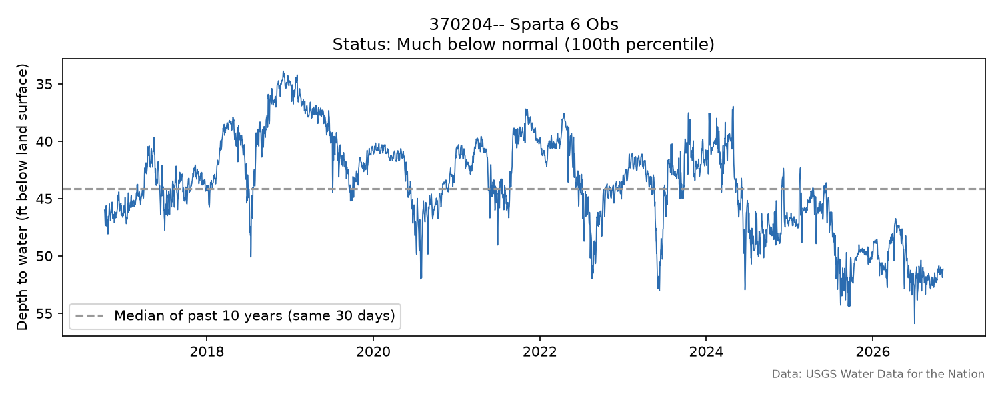

# NJ Water Risk: Contaminated Sites and Groundwater Levels

Two questions about drinking water risk in New Jersey:

1. Which public water systems have the most known contaminated sites inside
   their service areas, and does the answer change once area size is taken
   into account?
2. Are groundwater levels below normal right now, and does that differ for
   areas outside public water service, where homes rely on private wells?


**[▶ Open the interactive map](https://ry-lie.github.io/nj-water-risk/)**(switch between site counts, site density, and groundwater wells)

## Key findings

- **Contaminated sites: density points to old urban cores, not large systems.**
  Veolia Water NJ Hackensack (1,252 sites) and NJ American Water – Raritan
  (1,193) lead by count, but per square mile Hoboken (137) and Jersey City
  (47) are far ahead.
- **755 of 12,595 contaminated sites (6%) are outside every public water
  service area**, where homes mostly rely on private wells.
- **35% of active USGS monitoring wells (34 of 96) have below-normal
  groundwater levels.** Most of the lowest are in southern New Jersey.
- **Service area does not predict groundwater status** (35.7% below normal
  inside vs. 35.0% outside), but the impact differs: outside, a household
  depends on its own well rather than a managed system with multiple sources.

---

## Part 1: Contaminated sites per public water service area


| Top 5 by count | Sites | Top 5 by density (≥1 sq mi) | Sites / sq mi |
|---|---|---|---|
| Veolia Water NJ Hackensack | 1,252 | Hoboken Water Utility | 137.1 |
| NJ American Water – Raritan | 1,193 | Jersey City MUA | 47.0 |
| Newark WD | 825 | Harrison WD | 46.0 |
| Jersey City MUA | 715 | Orange WD | 32.5 |
| Passaic Valley WC | 459 | Atlantic City MUA | 31.5 |

- Raritan covers 429 sq mi, so its density is only 2.8 sites per sq mi.
- Hoboken has about three times Jersey City's density. Harrison, Orange,
  Atlantic City, Camden and Bayonne enter the top 10 by density, though none
  is in the top 10 by count.

## Method

1. **Data**: two NJDEP layers (below), both in NJ State Plane feet (EPSG:3424).
2. **Cleaning**: 8 service-area polygons had invalid geometry. QGIS stopped at
   the first one; the Python pipeline checks every feature and repairs them
   with `make_valid()`.
3. **Spatial join**: each contaminated site (point) is assigned to the service
   area (polygon) it falls within.
4. **Normalization**: sites per square mile, excluding areas under 1 sq mi to
   avoid inflated densities.
5. **Storage and queries**: results are written to SQLite and the findings
   above are answered with SQL (`outputs/query1.csv` – `query3.csv`).
6. **Validation**: the top 5 counts from the Python pipeline match the manual
   QGIS analysis exactly.

---

## Part 2: Groundwater levels



| Status | Wells | Avg. change vs. usual |
|---|---|---|
| Much below normal (≥ 90th pct.) | 23 | 3.6 ft deeper |
| Below normal (75–90th) | 11 | 2.5 ft deeper |
| Normal | 38 | ~0 ft |
| Above normal (≤ 25th) | 24 | 1.9 ft shallower |

- **Location matters more than service area.** On the map, most "much below
  normal" wells are in southern New Jersey. One hypothesis is the difference
  in aquifers (Coastal Plain sands in the south vs. bedrock and glacial
  deposits in the north); checking each well's aquifer code is the next step.
- The example above (Sparta, outside any public water area) has been trending
  down since mid-2024 and is now about 8 ft below its 10-year median for this
  time of year.

**Method**

1. **Data**: daily depth to water (USGS parameter 72019) for New Jersey wells,
   last 10 years, from the new USGS Water Data API (the legacy `gwlevels`
   service was retired in 2026).
2. **Filtering**: 359 wells have daily data; 96 have a reading in the last
   60 days and at least 5 years of history.
3. **Status**: each well's latest 30-day average is compared with the same
   30-day window in each of the previous 10 years, so seasonal swings are not
   mistaken for drought.
4. **Spatial join**: each well is matched to the public water service area
   from Part 1, if any.

---

## SQL

Results from both parts are stored in one SQLite database
(`outputs/nj_water_risk.db`, tables `service_areas`, `sites`, `wells`) and
the findings above are answered with SQL queries (`outputs/query1.csv` –
`query5.csv`).

## Limitations

- Known Contaminated Sites include sites where cleanup is complete or in
  progress, so a site count is not a measure of drinking water quality.
- Service area boundaries are from 2017; some have not been updated.
- Monitoring wells tap different depths and aquifers, so a monitoring well is
  not necessarily drawing from the same layer as nearby private wells.

## Project structure

```
nj-water-risk/
├── scripts/
│   ├── part1b_analysis.py     # clean, spatial join, density, SQLite, SQL
│   ├── part2_groundwater.py   # USGS download, groundwater status, SQL, chart
│   └── part1c_webmap.py       # interactive Leaflet map (folium) -> docs/
├── outputs/
│   ├── maps/                  # QGIS map and groundwater chart
│   ├── groundwater_wells.*    # well status (CSV, GeoJSON)
│   └── query*.csv             # SQL query results
├── docs/index.html            # interactive map (GitHub Pages)
└── nj-water-risk.qgz          # QGIS project
```

## Run it

```bash
python3 -m venv .venv
source .venv/bin/activate
pip install geopandas folium matplotlib

# download both layers as shapefiles into data/purveyor/ and data/kcsl/
python scripts/part1b_analysis.py
python scripts/part2_groundwater.py
python scripts/part1c_webmap.py
```

## Data

- *Purveyor Service Areas of New Jersey* (`Util_drinkingwater_PSA`) –
  NJDEP Bureau of Water Resources and Geoscience
- *Known Contaminated Site List for New Jersey* (`Envr_NJEMS_KCSL`) – NJDEP
- *Groundwater levels* – USGS Water Data for the Nation (public domain),
  via the `dataretrieval` Python package

NJDEP layers are from the [NJGIN Open Data portal](https://njogis-newjersey.opendata.arcgis.com),
accessed November 2026. Raw data is not included in this repository.

> This project uses data from the NJDEP Bureau of GIS but is not endorsed by
> NJDEP. Known Contaminated Sites can include sites where cleanup is complete
> or in progress, so a site count is not a measure of drinking water quality.

## Tools

Python (geopandas, pandas, folium), SQLite, QGIS, USGS Water Data API
