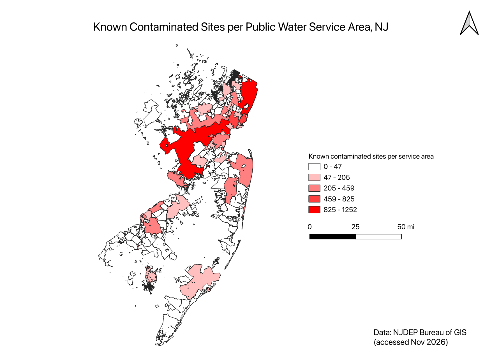

# NJ Water Risk: Contaminated Sites and Public Water Service Areas

Which New Jersey public water systems have the most known contaminated sites
inside their service areas, and does the answer change once area size is
taken into account?

**[▶ Open the interactive map](https://YOUR-GITHUB-USERNAME.github.io/nj-water-risk/)**



## Key findings

- **Raw counts point to large suburban systems; density points to old urban cores.**
  Veolia Water NJ Hackensack (1,252 sites) and NJ American Water – Raritan
  (1,193) lead by count, but Raritan covers 429 sq mi, so its density is only
  2.8 sites per sq mi.
- **Hoboken has the highest density: 137 sites per sq mi**, about three times
  Jersey City (47). Harrison, Orange, Atlantic City, Camden and Bayonne also
  enter the top 10 by density, though none is in the top 10 by count.
- **755 of 12,595 sites (6%) are outside every public water service area.**
  Those areas mostly rely on private wells, which are not monitored like
  public systems. This is the starting point for the groundwater analysis
  (Part 2, in progress).

| Top 5 by count | Sites | Top 5 by density (≥1 sq mi) | Sites / sq mi |
|---|---|---|---|
| Veolia Water NJ Hackensack | 1,252 | Hoboken Water Utility | 137.1 |
| NJ American Water – Raritan | 1,193 | Jersey City MUA | 47.0 |
| Newark WD | 825 | Harrison WD | 46.0 |
| Jersey City MUA | 715 | Orange WD | 32.5 |
| Passaic Valley WC | 459 | Atlantic City MUA | 31.5 |

## Method

1. **Data**: two NJDEP layers (below), both in NJ State Plane feet (EPSG:3424).
2. **Cleaning**: 8 service-area polygons had invalid geometry. QGIS stopped at
   the first one; the Python pipeline checks every feature and repairs them
   with `make_valid()`.
3. **Spatial join**: each contaminated site (point) is assigned to the service
   area (polygon) it falls within.
4. **Normalization**: sites per square mile, excluding areas under 1 sq mi to
   avoid inflated densities.
5. **Storage and queries**: results are written to SQLite and the findings
   above are answered with SQL (`outputs/query1.csv` – `query3.csv`).
6. **Validation**: the top 5 counts from the Python pipeline match the manual
   QGIS analysis exactly.

The Known Contaminated Sites List is updated daily by NJDEP, so the whole
analysis can be refreshed by downloading the data again and re-running the
scripts.

## Project structure

```
nj-water-risk/
├── scripts/
│   ├── part1b_analysis.py   # clean, spatial join, density, SQLite, SQL queries
│   └── part1c_webmap.py     # interactive Leaflet map (folium) -> docs/
├── outputs/
│   ├── maps/                # static map exported from QGIS
│   └── query*.csv           # SQL query results
├── docs/index.html          # interactive map (GitHub Pages)
└── nj-water-risk.qgz        # QGIS project
```

## Run it

```bash
python3 -m venv .venv
source .venv/bin/activate
pip install geopandas folium matplotlib

# download both layers as shapefiles into data/purveyor/ and data/kcsl/
python scripts/part1b_analysis.py
python scripts/part1c_webmap.py
```

## Data

- *Purveyor Service Areas of New Jersey* (`Util_drinkingwater_PSA`) –
  NJDEP Bureau of Water Resources and Geoscience
- *Known Contaminated Site List for New Jersey* (`Envr_NJEMS_KCSL`) – NJDEP

Both from the [NJGIN Open Data portal](https://njogis-newjersey.opendata.arcgis.com),
accessed November 2026. Raw data is not included in this repository.

> This project uses data from the NJDEP Bureau of GIS but is not endorsed by
> NJDEP. Known Contaminated Sites can include sites where cleanup is complete
> or in progress, so a site count is not a measure of drinking water quality.

## Tools

Python (geopandas, pandas, folium), SQLite, QGIS
